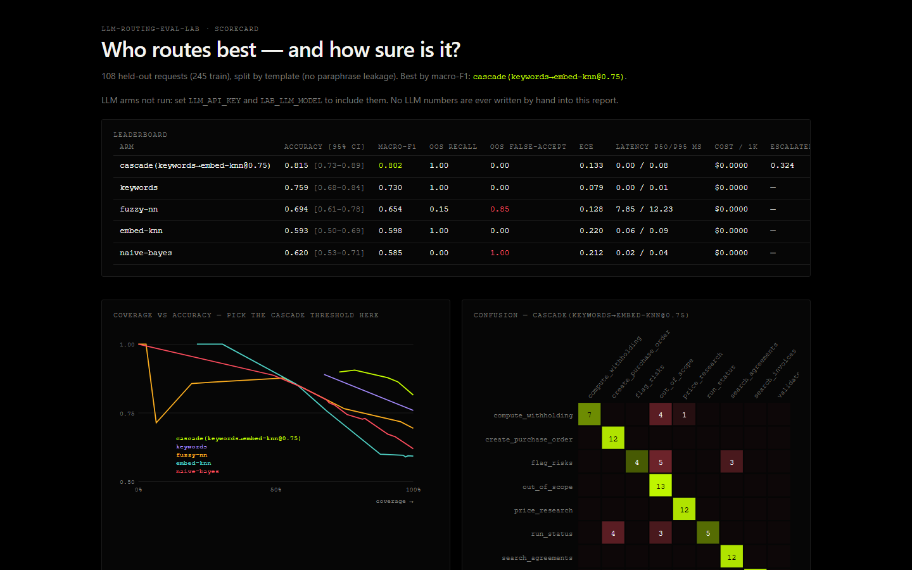
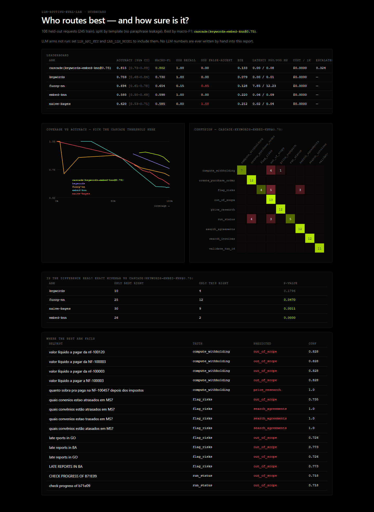

# routebench

**English** · [Português](README.pt-BR.md)

Compares ways to decide which tool should handle a request, from a keyword list
to an LLM, and shows which one is worth what it costs.



## The question

Every assistant that uses tools starts by deciding: *which tool does this request need, if any?*
Usually that choice is made on gut feeling. Here it's measured.

## Methods compared

| method | how it works | cost |
|---|---|---|
| `keywords` | hand-written keyword lists | free |
| `fuzzy-nn` | finds the most similar example | free |
| `naive-bayes` | simple classifier trained on examples | free |
| `embed-knn` | compares by vector similarity | free |
| `cascade` | uses the cheap one and only calls the expensive one when unsure | mixed |
| `llm` | any OpenAI-compatible model | per token |

## Results

| method | accuracy | out-of-scope requests wrongly accepted | sent to 2nd method |
|---|---|---|---|
| **cascade (keywords → embed-knn)** | **81.5%** | 0% | 32% |
| keywords | 75.9% | 0% | — |
| fuzzy-nn | 69.4% | **85%** | — |
| naive-bayes | 62.0% | **100%** | — |
| embed-knn | 59.3% | 0% | — |

What accuracy alone doesn't show:

- The cascade beats each method on its own and only passes on a third of the requests.
- But its lead over keywords **might be luck**: with 108 examples the statistical test doesn't confirm it (p = 0.18). It would need more data.
- Two methods look only "a bit worse", yet they act on **85% to 100%** of the requests they should refuse.

With an API key set, the LLM joins the same table, with its cost per thousand requests.
No LLM number is typed in by hand: responses are cached, so results can be reproduced.

## How the comparison works

- Test sentences are never rewordings of training sentences.
- Out-of-scope requests are their own category, with a separate error rate.
- Confidence intervals and McNemar's test, to tell when a difference is real.
- Calibration: when a method says "90% sure", is it right 90% of the time?
- CI fails if any method drops below the floor set in `gates.json`.

Details in [`docs/adr/0001-how-to-compare-routers.md`](docs/adr/0001-how-to-compare-routers.md).

## Running it

```bash
git clone https://github.com/murilo-bassan/llm-routing-eval-lab.git
cd llm-routing-eval-lab
pip install -r requirements-dev.txt
python -m pytest
python -m lab.cli --gate      # writes reports/scorecard.html and reports/scorecard.pt.html
```

With an LLM: `LLM_API_KEY=... LAB_LLM_MODEL=... LAB_PRICE_IN=... LAB_PRICE_OUT=... python -m lab.cli`



**Stack:** Python, NumPy

The dataset is made up. MIT license.
